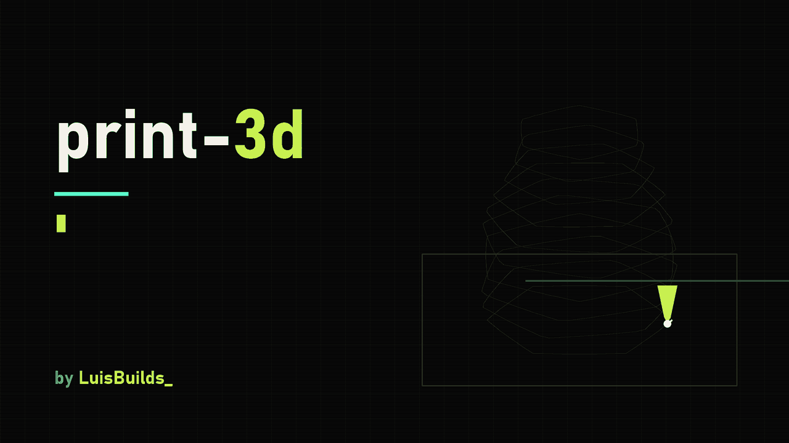

# print-3d — una skill de Claude que diseña piezas imprimibles para *tu* impresora



[English](README.md)

Dile a Claude *«hazme un soporte de pared para dos ventiladores de 92 mm»* y recibes un STL validado (y si quieres
3MF/STEP) a la medida de tu impresora, con los ajustes explicados con los nombres de tu laminador.

- **Formulario inicial (una sola vez)**: impresora, boquilla, laminador, materiales, firma, formatos y estilo. Se guarda en
  `~/.claude/print-3d/profile.json`: cada sesión nueva (o cada computadora) arranca conociendo tu máquina.
- **36 impresoras precargadas** (Bambu Lab, Prusa, Creality, Elegoo, Anycubic, QIDI, Sovol, Flashforge, Snapmaker,
  Voron) y entrada manual para cualquier otra.
- **CAD por código** (build123d) con piezas probadas: agujeros de tornillo (avellanados y a taco), insertos térmicos,
  tuercas, imanes, cajas con tapa, texto, VESA, colgadores, agujeros en lágrima.
- **Validación de cada archivo**: malla cerrada, cabe en la cama, voladizos > 45°, puentes, paredes finas, apoyo,
  gramos de filamento, choques entre piezas montadas y medidas exactas por secciones.
- **Edición de STL**: escalar, cortar, unir, restar, espejo, reparar, poner la mejor cara abajo.
- **Aprende tus holguras**: cuéntale cómo encajó y esa holgura probada pasa a ser la nueva por defecto.
- **Gasta pocos tokens**: la API está en la skill, primero números y luego imágenes, y trae los datos de consulta
  (materiales, menús de laminadores, medidas de ventiladores, Raspberry Pi, rodamientos, pilas…) sin buscar en la web.
- Opcional: tu firma en relieve en cada pieza y paquete de fotos para Printables/MakerWorld con Blender.

## Instalar (Claude Code — recomendado)
Requisito: [uv](https://docs.astral.sh/uv/) (instala Python y las librerías de CAD solo la primera vez, ~1 min).

```bash
git clone https://github.com/luisbuilds-dev/print-3d-skill && cd print-3d-skill
./install.sh          # macOS / Linux
```
```powershell
.\install.ps1         # Windows
```
Copia `print-3d/` a `~/.claude/skills/print-3d`. Abre Claude Code y di *«configura mi impresora 3D»*, o pide una pieza
directamente: el formulario sale solo la primera vez.

**claude.ai**: sube `dist/print-3d.zip` en *Configuración → Capacidades → Skills*. El entorno de código no guarda
archivos entre chats, así que el perfil se vuelve a pedir (o pega tu `profile.json`).

## Ejemplos
- «Diseña una caja de 80×60×40 con tapa corredera en PETG»
- «Agranda este STL un 20 % pero deja los agujeros M3 igual» (arrastra el archivo)
- «Corta este casco en dos para que quepa en mi cama»
- «La tapa quedó muy apretada» → se guarda como holgura probada
- «Ahora mi boquilla es de 0,6» / «ya no quiero firma»

## Autor
Hecho por **LuisBuilds_** — [github.com/luisbuilds-dev](https://github.com/luisbuilds-dev) · Instagram/TikTok @luisbuilds_.
Licencia MIT (ver LICENSE). Las medidas de las impresoras se revisaron en noviembre de 2026; las marcadas «verify»
salen de una sola fuente y el formulario te pide confirmarlas.
