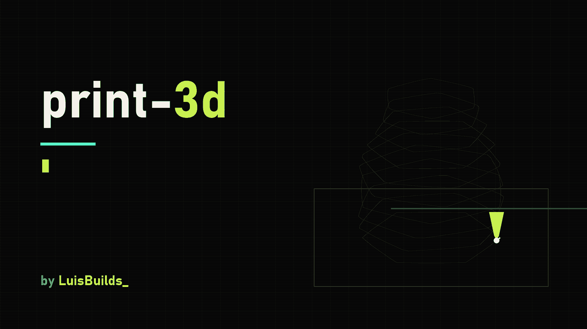

# print-3d — a Claude skill that designs printable 3D parts for *your* printer



[Español](README.es.md)

Tell Claude *"make me a wall bracket for two 92 mm fans"* and you get a validated STL (and optionally 3MF/STEP)
sized for your printer, with slicer settings in your slicer's own words.

- **One-time setup form**: printer, nozzle, slicer, materials, signature, file formats and style. It is saved to
  `~/.claude/print-3d/profile.json`, so every new session (or computer) starts already knowing your machine.
- **36 printer presets** (Bambu Lab, Prusa, Creality, Elegoo, Anycubic, QIDI, Sovol, Flashforge, Snapmaker, Voron),
  plus manual entry for anything else.
- **Code CAD** (build123d) with tested features: screw holes (incl. countersunk and wall-plug), heat-set inserts,
  nut pockets, magnets, boxes with lids, text, VESA, keyhole hangers, teardrop holes.
- **Printability check** of every file: watertight mesh, fits the bed, overhangs > 45°, bridges, thin walls, bed contact,
  grams of filament, collisions between assembled parts, exact cross-section measurements.
- **STL editing**: scale, cut, join, subtract, mirror, repair, put the best face down.
- **Learns your fits**: report how a print fitted and the tested clearance becomes the new default.
- **Low token use**: the API is in the skill file, numbers before images, reference data (materials, slicer menus,
  common hardware like fans, Raspberry Pi, bearings, batteries) shipped with the skill instead of web searches.
- Optional: your signature embossed on every part; Printables/MakerWorld photo pack with Blender.

## Install (Claude Code — recommended)
Requirements: [uv](https://docs.astral.sh/uv/) (it installs Python and the CAD libraries by itself on first use, ~1 min).

```bash
git clone https://github.com/luisbuilds-dev/print-3d-skill && cd print-3d-skill
./install.sh          # macOS / Linux
```
```powershell
.\install.ps1         # Windows
```
This copies `print-3d/` to `~/.claude/skills/print-3d`. Start Claude Code and say *"set up my 3D printer"* —
or just ask for a part; the form runs automatically the first time.

**claude.ai**: upload `dist/print-3d.zip` in *Settings → Capabilities → Skills*. The code sandbox does not keep
files between chats, so the profile is asked again (or paste your `profile.json`).

## Use
- "Design a box 80×60×40 with a sliding lid for PETG"
- "Make this STL 20 % bigger but keep the M3 holes" (drop the file)
- "Cut this helmet in two so it fits my bed"
- "The lid was too tight" → saved as a tested clearance for next time
- "Change my nozzle to 0.6" / "no signature from now on"

## Layout
```
print-3d/
  SKILL.md                 instructions Claude reads (English; replies in your language)
  profile.default.json     generic defaults (your profile overrides them)
  examples/                a filled profile (Elegoo Centauri Carbon)
  references/              onboarding form, printers, materials, slicers, hardware, design rules, build123d, recipes
  scripts/                 cad.py (build/check/measure) · stl.py · lib3d.py · printer_profile.py · publicar.py
```
Internal code and report words are partly Spanish (the original author's language); Claude handles both.

## Author
Made by **LuisBuilds_** — [github.com/luisbuilds-dev](https://github.com/luisbuilds-dev) · Instagram/TikTok @luisbuilds_.
License: MIT (see LICENSE). Printer specs were checked in November 2026; presets marked "verify" come from a single
source — the form asks you to confirm them.
